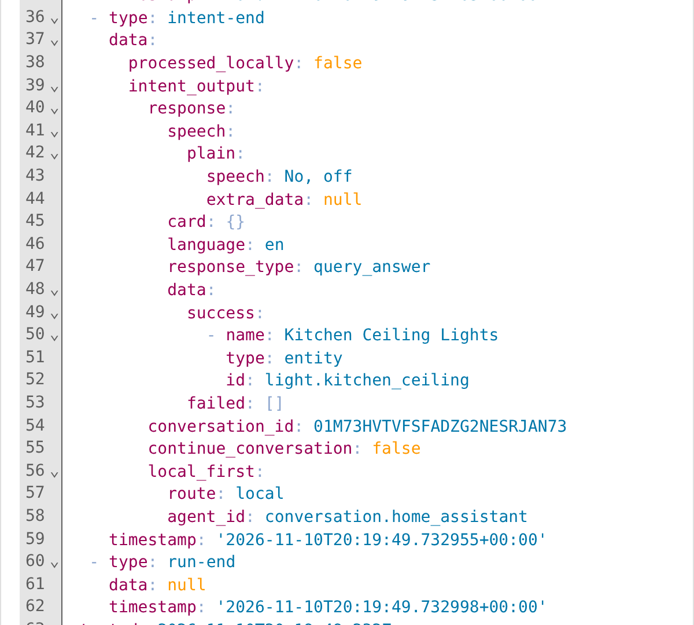
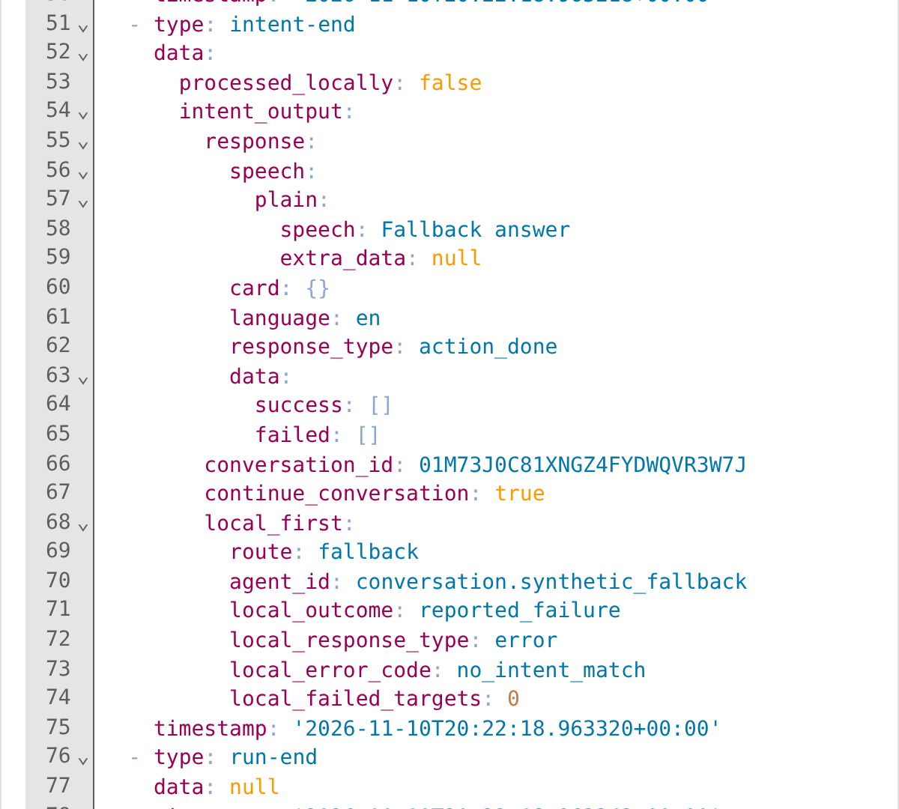

# ha-local-first-conversation

A standalone Home Assistant custom integration that routes requests through **strict local intent matching with validated state queries → an existing LLM conversation agent**.

**Compatibility spike, not a public-release package.** Tested on Home Assistant **2026.11.1**, with synthetic devices and a synthetic fallback agent. No live household or external model was used. See the [compatibility findings](docs/compatibility.md) for evidence and limits.

## Why this exists

An LLM can answer open-ended questions, but it does not need to handle every supported household command or state question. This integration gives HA's strict local intent handler the first opportunity to answer. Successful local answers return directly—even “off,” “no,” or a query reporting an unavailable state. The configured LLM handles requests that do not pass the local policy or that local handling cannot complete.

This differs from HA's **Prefer handling commands locally** shortcut in the tested version:

- **Validated state queries stay local.** In HA 2026.11.1, the pipeline shortcut excludes `HassGetState` when the selected agent advertises device-control support. This router instead retains queries using HA's finite state vocabularies. Wildcard person locations must match `home`, `not_home`, or a configured zone's canonical name. Other wildcard query slots go to the LLM. “Who is the founder of Home Assistant?” therefore does not become a local person-location query.
- **Gazetteer recovery is temporarily disabled.** The original design tried HA's gazetteer before the LLM. Testing the full agent on HA 2026.11.1 showed that “turn on the kitchen lights at 9 pm” and “do not turn on the kitchen lights” could turn lights on immediately and report success. The strict shortcut handed those requests to fallback instead. The interim policy uses strict handling only: misspelled names and pronoun follow-ups reach the LLM. Restoring gazetteer requires safer interpretation and validation before execution, not checking its response afterward.
- **Reported handling failures reach the LLM.** Routing checks top-level errors and failed targets, not just `NO_INTENT_MATCH`. An unavailable device preventing a command, or a response with both completed and failed targets, causes a handoff with the available local results. A successful query *reporting* an unavailable state is not a failed command.

These are routing differences, not measured claims about household latency, model quality, or cost. HA's shortcut remains useful when its behavior matches your needs. This integration adds no classifier, model credentials, companion service, or core patches.

Delayed commands such as “turn on the lights in five minutes” also go to the LLM. HA's delayed-command handler can later call the unguarded full agent, so the interim policy rejects its `conversation_command` slot before a timer is created. This does not cancel timers created before an update. Ordinary HA timer intents without a conversation command remain subject to HA's normal device requirements.

## Try the spike in a test instance

### Install the integration files

Open this project's public GitHub repository in **Marketplace** with the button below. Add it as a custom **Integration** repository if prompted, download it, and restart HA. This repository is not included in the default catalog.

[](https://my.home-assistant.io/redirect/marketplace_repository/?owner=farooqu&repository=ha-local-first-conversation&category=integration)

For manual installation, copy `custom_components/local_first_conversation` from the [public repository](https://github.com/farooqu/ha-local-first-conversation) into your HA configuration's `custom_components` directory, then restart HA.

### Add and select the router

After the files are installed and HA has restarted, this button opens the integration's setup form in your instance. **It does not download or install the files.**

[](https://my.home-assistant.io/redirect/config_flow_start/?domain=local_first_conversation)

1. Use HA 2026.11.1. The integration rejects older versions; newer versions have not been verified.
2. Configure an LLM integration normally, including its allowed tools and exposed entities.
3. Use the button above, or add **Local First Conversation** under **Settings → Devices & services → Add integration**. Give it a name and select the existing fallback conversation entity.
4. Select the new router as the conversation agent in your Assist pipeline. **Disable Prefer handling commands locally** in that pipeline; the router owns that decision. HA's sentence triggers still run normally.
5. Test with synthetic devices before considering household use. Change the fallback through the integration's options. Router-to-router fallbacks, including self-selection, are rejected.

Setup accepts existing non-router conversation entities; it cannot prove an arbitrary agent is an LLM or honors the handoff prompt. Select one that consumes `ConversationInput.extra_system_prompt`. The spike does not yet include default-catalog inclusion, release automation, a compatibility matrix across HA releases, or a license decision for public release.

### Integration-specific settings

The setup form needs only a **name** and an existing **fallback conversation agent**. Select your configured LLM agent—for example, **Ollama**, as shown below—not Home Assistant's built-in local agent. The router uses HA's strict intent handler first; no gazetteer setting is exposed.


In **Settings → Voice assistants**, open your assistant and select **Local First Conversation** under **Conversation agent**. Turn **Prefer handling commands locally** off, then save. The router owns local matching and validation; the pipeline shortcut could otherwise handle requests before this policy runs.


The gear beside the conversation agent is **Agent settings**. It opens the router's **Options** dialog shown below, where you choose the fallback—not the pipeline's conversation agent. You can also reach this dialog through **Settings → Devices & services → Local First Conversation → Configure**. To change the fallback, select the replacement and submit. Existing model credentials and tool permissions remain in the selected agent's integration.


These are captures of the real HA 2026.11.1 frontend with HA's Ollama integration in an isolated test instance. The router setup accepted the Ollama conversation entity, and its options show the saved selection. The pipeline was saved and reopened to verify the router selection and disabled shortcut; its Agent settings button opened the same Options dialog. Ollama's model-list endpoint was stubbed locally; no model inference was run. These screenshots demonstrate configuration, not provider behavior. No marketplace setup or live-household configuration is shown.

### See which agent answered

Open your assistant's **Debug** view, select a run, and expand the **Raw** panel at the bottom of the timeline. Find `intent → intent_output → local_first` (also present in the `intent-end` event):

- `route: local` with `agent_id: conversation.home_assistant` means HA's built-in agent returned the answer.
- `route: fallback` identifies the configured destination in `agent_id`. `local_outcome`, `local_response_type`, `local_error_code`, and `local_failed_targets`, when available, explain the handoff. Check the final `response_type` too: a fallback error does not mean the LLM answered successfully.

`local_outcome: not_handled` means strict local handling returned no accepted response, including a policy rejection. `reported_failure` means local handling returned an error or failed targets; `uncertain` means it raised or timed out. Failure and timeout are not proof that nothing executed. HA can discard matching errors, so the handoff also retains any available tool outcomes.

The timeline's **Engine** still names the router. In HA 2026.11.1, **Processed locally** describes HA's own shortcut and can show `false` even when this router returned a local answer. Use `local_first` for the router's decision. That release's smaller NLP **Raw** panel rendered blank during testing; the bottom full-run **Raw** panel displayed the data correctly. The downloadable debug JSON also includes it.

These cropped captures show the actual HA 2026.11.1 debug output for a local state question and a synthetic fallback answer before the strict-policy update. The metadata location is unchanged; a no-match handoff now reports `not_handled` instead of a full-agent `no_intent_match` error. The captures do not demonstrate a real model request.





Metadata is added only to results from the updated router, not to older runs or requests handled before the router, such as pipeline sentence triggers. A local route identifies HA's strict handler as the built-in local destination. The metadata adds no text to the spoken answer or model prompt and creates no separate transcript log. The fields use HA's existing pipeline/debug retention.

## Safety and conversation limits

- The original utterance, language, user context, device ID, and satellite ID are passed through. HA still controls exposure, authorization, and session ownership; the router grants no extra tools or permissions.
- The local branch has a separate HA-managed chat session to keep provisional local replies out of the fallback's user/assistant history and Assist stream. Every turn starts locally; routing is not sticky. Gazetteer references are disabled: “close them” goes to the LLM even after an explicit local command.
- Person-location validation uses canonical HA state spelling, including case. For the home zone, that is `home`, not its display name. A differently spelled location goes to the LLM rather than producing a potentially incorrect negative answer. Validation uses configured zones, not only currently observed person states.
- This is a narrower acceptance policy, not a general semantic-safety guarantee. User-authored sentence triggers and custom intent handlers remain trusted HA configuration; the router does not sandbox them. The selected LLM can still use its existing tools and permissions.
- Fallback receives the original request plus this turn's available local response, target lists, and local tool outcomes in `extra_system_prompt`. Those details can contain household names and go to the selected provider. Earlier successful local replies can also be included in later LLM conversation history. There is no router-specific transcript logging; normal HA traces and provider logging policies still apply.
- Partial completion is not atomic. Prompt guidance asks the LLM not to repeat completed actions, but **does not guarantee exactly-once execution**. Unknown completion, late background service failures, and provider behavior remain limits. Do not use this spike where hard no-replay enforcement is required.
- Streaming fallback text and the continuation flag passed the synthetic Assist intent-stage test. Local answers and non-streaming destinations are buffered. Real provider requests, audio/TTS playback, and pronouns referring only to LLM actions remain unverified.

## Run the compatibility tests

### Latest stable HA in an Amp orb

Run the repository's setup script to prepare this integration's isolated test environment:

```sh copy Copy Latest Test Commands
.agents/setup
.venv/bin/python -m pytest -q
.venv/bin/ruff check custom_components tests
.venv/bin/ruff format --check custom_components tests
```

Setup installs the latest Python 3.14 patch release, the latest stable HA release reported by PyPI, HA's declared conversation/Assist dependencies, and the test tools. It prints the resolved versions. It does not start HA, connect to a household, or configure a marketplace. Amp runs it when preparing a new project snapshot; reused snapshots may retain an earlier release until setup runs again.

Verified on 2026-11-10: setup into an empty virtual environment took 3 seconds with the orb's package cache populated; a repeat took 1 second. HA resolved to **2026.11.1**, Python to **3.14.7**, and the original 12-test suite passed. The strict-policy suite now passes **23 tests** on those HA/Python versions. These are cached-install timings, not fresh-orb download estimates. A future latest release is not verified merely because setup installs it: run the contract tests and investigate failures before using it.

### Reproduce the original spike versions

Python 3.14.2, `uv`, and a C/C++ build toolchain are needed for the pinned HA and Assist dependencies. Use a fresh virtual environment when switching from the latest-release workflow:

```sh copy Copy Pinned Test Commands
uv venv --python 3.14.2
uv pip install -r requirements-test.txt
.venv/bin/python -m pytest -q
.venv/bin/ruff check custom_components tests
.venv/bin/ruff format --check custom_components tests
```

Tests boot the released HA package with real registries, strict sentence matching, intent handlers, conversation sessions, config/options flows, and Assist intent-stage processing. The router does not invoke gazetteer. Devices and the model destination are synthetic. Network connections are restricted to loopback; no household credentials are required.

[Source](https://github.com/farooqu/ha-local-first-conversation) · [Issues](https://github.com/farooqu/ha-local-first-conversation/issues)
