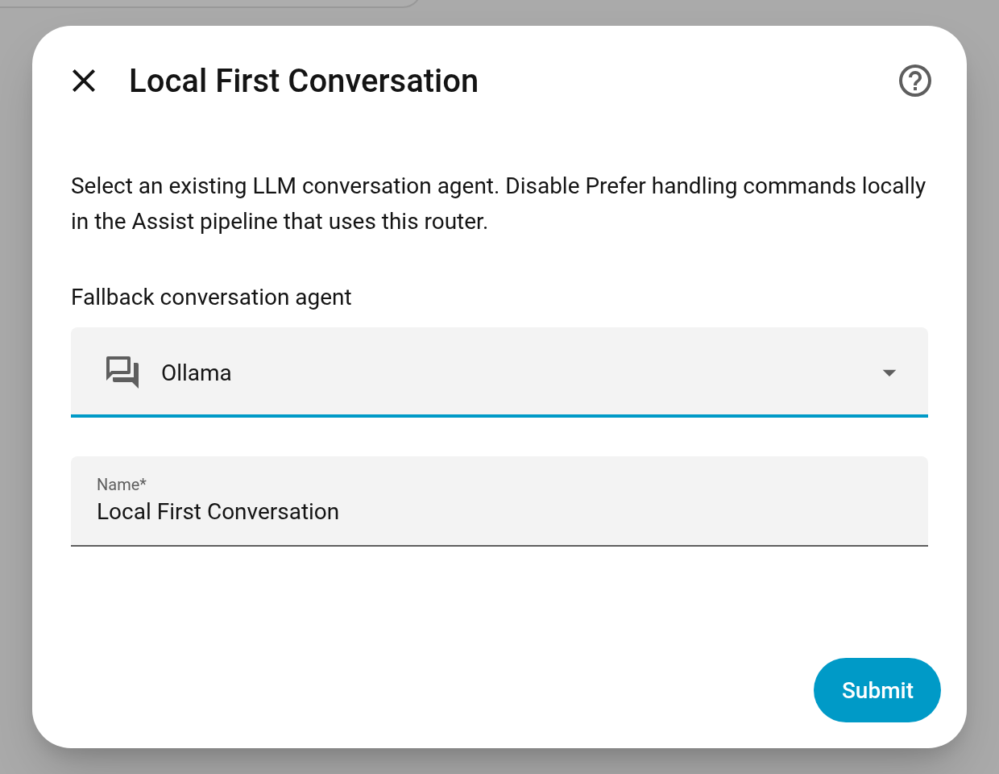
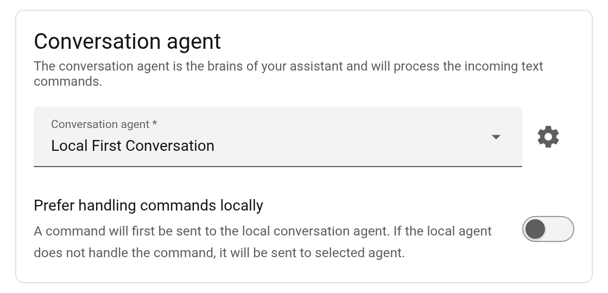
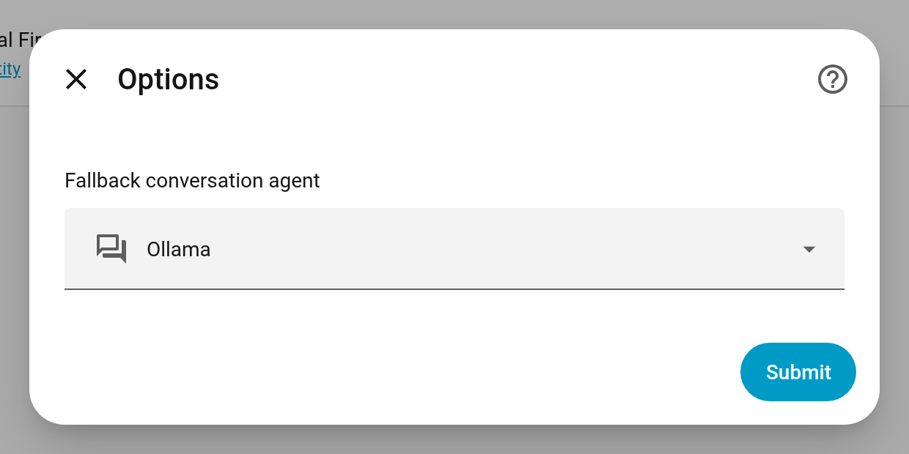

# Local First Conversation

A Home Assistant integration that handles supported commands and state questions locally, then sends unresolved requests to your existing LLM conversation agent. It uses Home Assistant's built-in intent handling; no additional model credentials or services are needed.

## How it works

Each request starts locally. Successful commands and state answers return directly; unmatched requests and handling failures go to the fallback agent. Available local results accompany the handoff so the fallback knows what was already attempted.

- **Commands and state questions:** exact device names and supported sentences stay local, including answers such as “off” or “unavailable.” Unlike HA 2026.11.1's **Prefer handling commands locally** shortcut, the router keeps supported state questions local even when the LLM can control devices.
- **Open-ended requests and follow-ups:** questions outside the local grammar, misspelled names, and pronouns such as “close them” go to the LLM.
- **Delayed commands:** requests such as “turn on the lights in five minutes” go to the LLM rather than creating a local timer. Whether they can be scheduled depends on that agent's tools.

## Install

Requires **Home Assistant 2026.11.1 or newer**. Only 2026.11.1 has been verified; see [compatibility](docs/compatibility.md) before upgrading HA.

Open the repository in **Marketplace**, add it as a custom **Integration** repository if prompted, download it, and restart HA. It is not in the default catalog.

To install manually, copy `custom_components/local_first_conversation` into your HA configuration's `custom_components` directory and restart HA.

## Configure

1. Configure your LLM integration, including its tools and exposed entities.
2. Add **Local First Conversation** under **Settings → Devices & services → Add integration**, or use the button below after installing the files.
3. Give it a name and select your LLM conversation agent as the fallback—for example, **Ollama**. Do not select Home Assistant's built-in agent or another Local First Conversation router.

The button opens setup; it does not install the files. See [fallback requirements](docs/compatibility.md#fallback-agents) if you use a third-party agent.

Under **Settings → Voice assistants**, open your assistant, select **Local First Conversation** as its **Conversation agent**, and turn **Prefer handling commands locally** off. Save the changes. This lets the router handle local matching instead of the pipeline shortcut; your sentence triggers still run normally.

To change the fallback, go to **Settings → Devices & services → Local First Conversation → Configure**, or use the **Agent settings** gear beside the pipeline's conversation agent. Select the replacement and submit. Credentials and tool permissions stay in the LLM integration.

## Check which agent handled a request

Open your assistant's **Debug** view, select a run, and expand the **Raw** panel at the bottom of the timeline. Under `intent → intent_output → local_first`:

- `route: local` means the local handler returned the answer.
- `route: fallback` identifies the selected fallback in `agent_id`. Check the final `response_type` for success or failure.

HA's **Processed locally** flag describes its own pipeline shortcut, not this router. Use `local_first` for the routing decision. See [routing diagnostics](docs/compatibility.md#routing-diagnostics) for handoff reasons and troubleshooting.

## Privacy and action safety

- The fallback receives the original request and available local results, which can include household names. Earlier local answers may also appear in later LLM conversation history. HA and your provider's normal logging policies apply; the router stores no separate transcript.
- HA exposure rules and permissions still apply. The router grants no extra tools and does not sandbox custom sentence triggers or intent handlers.
- A failed or timed-out request may have completed some actions. The handoff asks the LLM not to repeat them, but cannot enforce exactly-once execution. Check device state before repeating an uncertain command.

## Updates

Use Marketplace to install published versions and read their [release notes](https://github.com/farooqu/ha-local-first-conversation/releases). Before the first release, Marketplace installs from the default branch. Default-branch installations may include unreleased changes.

[Changelog](CHANGELOG.md) · [Compatibility and tests](docs/compatibility.md) · [Release instructions](docs/releasing.md) · [Report an issue](https://github.com/farooqu/ha-local-first-conversation/issues)
